# Implementation Plan: C++14 compiler plug-in (compilers/cpp)
  
##  Problem Statement
  
  Add a compiler plug-in that runs C++14 programs in the IDE and on both simulators. It is a translator written in portable C and compiled by our C11
  compiler, as MMIX and VBNET are. It converts C++ to C11, and the existing C11 compiler produces the assembly. Scope is broad: classes, inheritance,
  virtual functions, templates, exceptions, RTTI, lambdas, move semantics, and a small custom standard library.
  
##  Requirements (from your answers)

  - Standard: C++14, plus small C++17 additions later (if constexpr, structured bindings, [[nodiscard]], inline variables).
  - Scope: templates, exceptions and RTTI are included.
  - Output: the translator emits C11, and the C11 compiler is chained after it. Chaining is done by a new translate_to key in config.properties and an IDE
  change. cppc does not call cc itself.
  - Debugging: #line support is added to the C11 compiler, so the debugger shows .cpp source lines.
  - Library: <iostream>, <string>, <vector>, <utility>, <algorithm>, <memory>, <exception>, <stdexcept>, <map>, <set>, <unordered_map>, <array>, <list>,
  <functional>, <sstream>, and <c*> wrappers.
  - Grammar: a hand-written recursive-descent parser follows grammars-v4/cpp/CPP14Lexer.g4 and CPP14Parser.g4. tests/antlr_check.sh compares accept and
  reject results with ANTLR.
  - Tests: hand-checked .expected files, differential runs against host g++ or clang++, and the ANTLR parse check.
  
##  Background (findings)

  - Plug-in contract: CompilerPlugin runs compiler_source with the source path as its argument. The compiler must write <source>.asm and exit 0. There is
  no chaining today. IDEApp.runWithMode calls compileSource(), and the chain hook goes there.
  - #line: the C11 preprocessor documents #pragma, #line and #warning as accepted and ignored (pp.asm header). C11 already emits .source "file", line
  directives, so #line has to change the file and line the lexer records.
  - Precedent: VBNET is the template. Its layout is src/*.c, rt/, lib/, grammar/, tests/, build.sh (compiles the translator with C11 into <name>.asm),
  plan.md, and system_prompt.md. The generated .asm is committed.
  - C11 limits that shape the output:
    - No float, bit-fields, VLAs, _Generic, or GNU extensions.
    - Every scalar is one 64-bit word, and char is a Unicode codepoint.
    - setjmp.h and function pointers exist, which is what exceptions and vtables need.
  
  - Assumptions to verify in the spike: char* arithmetic counts words, so base-class offsets can be done with char*. Also, sizeof values are in words.
  - Known behavior differences from g++: int is 64-bit, float maps to double, sizeof differs, and bit-fields would be lowered to shifts and masks.
  Differential tests avoid these.
  
##  Proposed Solution

```mermaid
  flowchart LR
    A[prog.cpp] --> B[cppc.asm: lexer + preprocessor]
    B --> C[parser: AST, symbol-aware]
    C --> D[sema: overloads, templates, conversions]
    D --> E[lowering: classes, vtables, exceptions, RTTI, lambdas]
    E --> F[prog.gen.c with #line]
    F --> G[C11 compiler cc.asm]
    G --> H[prog.asm with .source = .cpp lines]
    H --> I[assemble + run/debug]
```

  - Preprocessor and lexer: a C++ preprocessor written in C (macros, #include, conditionals, raw strings, digit separators). C11's preprocessor is
  assembly and can't be reused. The translator expands macros before parsing.
  - Parser: recursive descent over CPP14. It keeps a symbol table while parsing to resolve declaration-vs-expression and template-argument ambiguities.
  - Sema: scopes and namespaces, name lookup (including ADL), overload resolution, implicit and user conversions, auto/decltype, and constexpr evaluation.
  Templates are instantiated by AST substitution (monomorphization).
  - Lowering to C:
    - Classes and references: classes become structs with a vptr. References become pointers. Names are mangled, and new/delete become malloc and
  constructor calls.
    - Virtual calls and inheritance: vtables are static arrays of function pointers. Multiple inheritance adjusts this by word offsets.
    - Exceptions: try/catch becomes setjmp. A cleanup-record stack runs destructors during throw before the longjmp.
    - Other features: lambdas become closure structs with an operator(). Range-for and structured bindings are desugared. RTTI uses generated type_info
  structs.
  
  - Library: lib/*.hpp in our C++ subset plus rt/cpp_rt.c for the runtime. Only used templates are instantiated, to keep compile time down on the
  simulator. The first release is whole-program. A prebuilt -lstd-style library is a possible later optimization.
  - Run flow: IDE reads translate_to=C11, runs cppc (writes <base>.gen.c), runs the C11 compiler on it, then assembles and runs as usual.
  
##  Task Breakdown
  
  Task 1: #line support in the C11 compiler
  - Objective: Make #line N "file" change the file and line recorded for tokens, so .source directives follow it.
  - Guidance: Edit pp.asm and the lexer and source tables. Register the file name in the file table without opening it.
  - Tests: Add C11 regression tests (97 exist). A #line 100 "x.cpp" test checks .source "x.cpp", 100 in the output. Error messages should also use the
  remapped line.
  - Demo: Compile a C file with #line and step through it in the debugger, which shows the remapped file and lines.
  
  Task 2: Plug-in skeleton and IDE chain hook
  - Objective: Create compilers/cpp with config.properties, build.sh, system_prompt.md and tests/run_tests.sh. The first cppc passes its input through
  unchanged. Add translate_to to CompilerPlugin and IDEApp.compileSource.
  - Guidance: file_extensions: cpp,cc,hpp,h, syntax_language: text/cpp, main_function: main, larger compiler_mem. Run the translator, then the named
  plug-in's compiler (building it if needed), then continue as today. Write errors to the console, as for other plug-ins. Update CompilerPlugin Javadoc
  and the README table.
  - Tests: A JUnit test for config parsing. A shell test that runs the chain on a C-compatible .cpp file.
  - Demo: File → New Compiler → C++. Run a printf hello world written as a .cpp file, through the chain.
  
  Task 3: Lexer and preprocessor
  - Objective: Tokenize full C++14 lexical syntax and preprocess it, with --tokens and --preprocess debug options.
  - Guidance: Include #include search paths (lib/, source directory), function-like macros, #/##, variadic macros, raw strings, u8/u/U literals, digit
  separators, __LINE__/__FILE__.
  - Tests: Token-dump tests against .expected files. Preprocessor tests compared with g++ -E token output.
  - Demo: cppc --preprocess expands a macro-heavy program correctly.
  
  Task 4: Parser and AST
  - Objective: Parse all of C++14 into an AST, with --ast and --parse-only.
  - Guidance: Copy the CPP14 grammar to grammar/ and note deviations in grammar/README.md. Keep a type-name table during the parse to resolve ambiguities.
  Parse templates fully, but do not instantiate them yet.
  - Tests: tests/antlr_check.sh runs ANTLR and cppc --parse-only on the same corpus. A deliberate-error corpus checks reject behavior. Keep an allow-list
  for known divergences.
  - Demo: cppc --ast prints the AST of a template-heavy program, and the ANTLR check passes on the corpus.
  
  Task 5: Sema and C codegen for the non-class core
  - Objective: Type-check and translate C++ that has no classes. It includes bool, references, function overloading, default arguments, namespaces,
  new/delete, enum class, static_assert, using, and auto.
  - Guidance: Types, scopes, name mangling, overload resolution (standard conversions only), constexpr evaluation of simple expressions, #line emission,
  and a first runtime file (rt/cpp_rt.c).
  - Tests: Differential tests for each feature (tests/run/*.cpp with .expected).
  - Demo: An overloaded-function program with namespaces and references runs in the IDE and debugs on .cpp lines.
  
  Task 6: Classes
  - Objective: Support members, access control, constructors with initializer lists, destructors, this, static members, copy constructor and assignment,
  operator overloading, conversion operators, and temporaries.
  - Guidance: Lower classes to structs plus mangled functions. Destroy automatic objects at scope exit, including on return/break/goto. Ignore exceptions
  for now. Always construct in place, which matches copy elision in practice.
  - Tests: Differential tests for construction and destruction order, copying, and operators.
  - Demo: A Vec2 and String-style class program prints identical constructor and destructor traces to g++.
  
  Task 7: Inheritance and virtual functions
  - Objective: Single and multiple inheritance, virtual functions, abstract classes, override/final, virtual destructors.
  - Guidance: Add the vptr and vtable generation with this adjustment for secondary bases. Verify the word-offset assumption first. Virtual base classes
  get a separate sub-step at the end of this task (vbase offsets in the vtable).
  - Tests: Differential tests for dispatch, diamond cases, and destruction through base pointers.
  - Demo: A shape hierarchy with virtual double area() runs correctly.
  
  Task 8: Minimal library, <iostream> and <string>
  - Objective: Provide cout, cin, cerr, endl, std::string (non-template at first), <cstdio>, <cstdlib>, <cstring>, <cmath>.
  - Guidance: Non-template classes in lib/. The library is compiled only when included. std::string stores one codepoint per word, like char in C11.
  - Tests: Library tests with .expected files and differential tests for formatting of numbers.
  - Demo: The classic std::cout << "Hello, " << name << std::endl; program with input from std::cin.
  
  Task 9: Templates
  - Objective: Function and class templates, explicit and partial specialization, deduction, default template arguments, member and alias templates,
  non-type parameters, typename/template disambiguators, enable_if-style substitution failure, variadic templates.
  - Guidance: Instantiate by AST substitution with a cache keyed by mangled arguments. Use lazy instantiation of member functions. Report instantiation
  context in error messages (limited depth).
  - Tests: Differential tests (max<T>, Stack<T>, traits, variadic sum). Error tests for deduction failure.
  - Demo: User-written Stack<T> and a variadic print(args...) run.
  
  Task 10: C++11 language features
  - Objective: auto/decltype, range-for, nullptr, lambdas (capture by value and reference, mutable, generic C++14 lambdas), rvalue references and move
  semantics, std::move/std::forward, initializer lists, uniform initialization, delegating constructors, = default/= delete, constexpr, noexcept,
  override, static_assert.
  - Guidance: Lambdas become closure structs. Move semantics need value-category tracking in sema. constexpr functions get an interpreter for constant
  expressions.
  - Tests: Differential tests per feature.
  - Demo: A program using lambdas with captures and a move-only class runs.
  
  Task 11: Exceptions
  - Objective: throw, try/catch (by type, by reference, catch (...)), rethrow, stack unwinding with destructors, noexcept, std::terminate, std::exception
  and <stdexcept>.
  - Guidance: Handler stack with setjmp, plus the cleanup-record stack. Register a record when an object with a non-trivial destructor is constructed and
  pop it when it is destroyed. Exception objects are heap-allocated and thrown by type descriptor. Destructors that throw call terminate.
  - Tests: Differential tests for unwinding order, nested try, throws from constructors (partially built objects), and uncaught exceptions.
  - Demo: A program that throws from deep recursion prints destructor traces identical to g++.
  
  Task 12: RTTI
  - Objective: typeid, type_info (name(), ==, before), dynamic_cast for pointers and references (including cross-casts), bad_cast.
  - Guidance: Emit a type_info per polymorphic class with a base list. Store a pointer to it in the vtable. dynamic_cast walks the hierarchy and adjusts
  offsets. This also lets catch match derived types.
  - Tests: Differential tests for downcasts, cross-casts, and failing casts.
  - Demo: A visitor-style program uses dynamic_cast and typeid correctly.
  
  Task 13: Library with templates, part 1
  - Objective: <utility> (pair, move, swap), <vector>, <array>, <algorithm> (sort, find, copy, reverse, ...), <memory> (unique_ptr, shared_ptr,
  make_unique, make_shared), <functional> (function, bind-lite, less/greater), and the iterator basics.
  - Guidance: Write in our C++ subset, keeping implementations simple. std::string becomes basic_string<char> if cheap, otherwise it stays a class. Watch
  compile time on the simulator and instantiate lazily.
  - Tests: Library tests with .expected files and differential tests.
  - Demo: A word-frequency program sorting a vector<pair<string,int>> with a lambda comparator.
  
  Task 14: Library with templates, part 2
  - Objective: <map>, <set>, <unordered_map>, <unordered_set>, <list>, <sstream>, <iomanip> basics.
  - Guidance: Red-black tree for ordered containers and chained hash tables for unordered ones. Iterator invalidation rules follow the standard where
  cheap.
  - Tests: Differential tests. Containers print in standard order. unordered_* tests do not depend on iteration order.
  - Demo: A program with map<string, vector<int>> and stringstream runs.
  
  Task 15: C++17 additions, polish and release
  - Objective: if constexpr, structured bindings, inline variables, [[nodiscard]]/[[maybe_unused]], nested namespaces, plus error-message quality,
  system_prompt.md for the AI chat, README and docs, installer check.
  - Guidance: Make sure compilers/cpp ships in the installers (the compilers/ folder is already installed without tests). Document the divergences from
  g++. Final run of the full regression suite, the ANTLR check, and a performance pass on compile time.
  - Tests: Full suite on both simulators (Java and native).
  - Demo: A sample project of several .cpp files runs from the IDE.
  
##  Risks

  - Compile time: this is the biggest risk. A template-heavy library compiled on the simulated CPU, twice (translator and C11), may be slow. Mitigations
  are lazy instantiation, small library implementations, and measuring early (Task 8 and Task 13).
  - Translator size: the translator has to compile under the C11 subset (no float, one word per scalar) and fit in its memory budget. Raise compiler_mem
  if needed.
  - Parser divergence: a hand-written parser will not match ANTLR everywhere. The allow-list needs review.
  - Whole-language scope: virtual bases and variadic templates are the likeliest to slip. They are the last steps inside Tasks 7 and 9.
  

## Measurements

- Task 3 (lexer + preprocessor), native simulator: a 226 KB file with 4000
  macro-heavy lines takes 6 s and 54 MB of heap (`--preprocess`); reading the
  file with `fread` alone costs 260 cycles per byte (the C11 library reads one
  byte at a time).  A simple loop iteration costs about 70 cycles and a
  function call about 100, so hot paths use macros and local variables.
  Tokens, names and hide sets come from an arena (`anew`).
- The preprocessor output matches `g++ -E` token for token on the dump tests
  (`HOST=1 tests/run_tests.sh`, `tests/ppcmp.py`).
- Task 5 (sema + C generation), native simulator: translating a 100-line
  program takes 17M cycles (0.3 s) with the library headers it includes.

## Differences from g++ (task 5)

- `int`, `long` and every pointer are one 64-bit word: arithmetic on `int`,
  `short`, `char` and `unsigned` does not wrap at 32, 16 or 8 bits, and
  `sizeof` counts words (`sizeof(int) == 1`).  Integer constants take their
  C++ types (an `int` literal is an `int` while it fits in 32 bits), so
  overloads and `auto` behave as in C++.
- `char` holds a Unicode codepoint; a string literal has one `char` per
  codepoint, not per UTF-8 byte.
- `float` and `long double` are `double`.
- Expressions with unspecified evaluation order (`f(x++, x)`) are evaluated
  in the order of the C11 compiler (right to left for arguments).
- References are pointers, `const`/`volatile` are checked by the translator
  and not written to the generated C.

## Classes (task 6)

- A class is a C `struct` (or `union`); a member function is a C function with
  a first parameter `this`; a constructor returns `this`.  Names:
  `Cls__f__sig`, `Cls__ctor__sig`, `Cls__dtor`, `Cls__op_plus__sig`, static data
  `Cls__name`.
- A class object that is a function result, or a by-value argument, is passed
  by address: the callee of a class-returning function gets the result object
  as the first parameter (`__ret`), and a by-value class parameter is a pointer
  to a temporary that the caller built (and destroys).  The `Val` of a class
  prvalue is the lvalue `(*ptr_expr)`.
- Temporaries get C variables at the top of the function and are destroyed at
  the end of the full expression; those created in the right operand of `&&`,
  `||` and in `?:` carry a flag.  Local objects are destroyed at scope exit,
  `return`, `break` and `continue` (not `goto`).
- Copy elision: a prvalue of the right type is built straight in the object
  that it initializes (`dest_hint`); a returned local object that every
  `return` returns is built in the result (NRVO), as g++ does.
- Implicit special members are generated when needed (`Cls__copy`,
  `Cls__assign`, `Cls__ctor__v`, `Cls__dtor`); trivial classes use C struct
  copies.  Not yet: base classes and virtual functions (task 7), bit-fields,
  `delete` through a base pointer, move semantics (task 10), pointers to
  members.
- Objects with static storage (globals, static locals) are constructed by
  `__cppc_init` and by a guard, and destroyed by `atexit`.

## Inheritance and virtual functions (task 7)

- A base class is a member `struct B __bN` of the derived struct, in the order
  of the base list; a polymorphic class whose first base is not polymorphic
  starts with `void **__vptr`, otherwise the primary base provides the vptr at
  offset 0.  Conversions to a base take the address of the member; downcasts
  subtract its offset (written with a null-pointer `&((D *)0)->__bN`, which
  is in words like everything else on CPUSim64).
- A vtable is `void *C__vtbl[]`: slot 0 is reserved for the type information
  (task 12), then one entry per virtual function.  Every polymorphic base
  subobject that is not the primary base has its own vtable `C__vtblK`; entries
  that need a different `this` point to generated thunks (`C__thunkN`).  The
  destructor slot holds the deleting destructor `C__deldtor`.  A virtual call
  casts the slot to the C function type and passes the subobject address of the
  class that owns the slot.
- Constructors construct the bases in order, then set the vptrs, then the
  members; destructors set the vptrs again first.  Implicit copy and assignment
  handle the bases; classes with a vptr always have them (the vptr is not
  copied).
- `override`, `final`, pure virtual functions and abstract classes are checked.
  Not supported: virtual base classes (diamond inheritance with `virtual`),
  covariant return types, private/protected inheritance checks on conversions.

## Library: iostream and string (task 8)
- `lib/string`: non-template `std::string` (one codepoint per word), `to_string`, `stoi`, `stol`, `stod`, comparison and `+` operators, `find`, `substr`, `c_str`.
- `lib/iostream`: `ostream`/`istream` with `<<`, `>>`, `getline`, `get`, `peek`; `cout`, `cin`, `cerr`, `clog` (dynamic initializers run through `__cppc_init`);
  `endl`, `flush`, `boolalpha`, `fixed`, `setw`, `setprecision`, `setfill` (`<iomanip>` includes `<iostream>`). User `operator<<`/`>>` (member, friend, free, ADL) work.
- Numbers are formatted with the C `printf` family, so output equals g++ for the tested cases.
- Friend functions defined inside a class now have their bodies translated after the class is complete.
- Copy-initialization through an `explicit` constructor or a missing conversion is an error.
- Measurement: translating `stream_basic.cpp` (iostream + string, 2579 lines of C) costs 200M cycles and 1.9M heap words (1.4 s on the Java simulator, 1.8 s native);
  the C11 compiler then needs 83M cycles for the generated C. Whole suite (95 tests): 63 s on the C11-built translator with SIM=java.
- Not implemented yet: `getline` with a delimiter on all overloads, `wchar_t` streams, `std::string` as a template (`basic_string`), file streams, `<sstream>` (task 14).

## Status

All 15 tasks are implemented.  The regression suite has 138 tests (run, error
and dump tests); they pass with the native build of the translator (with the
g++ comparison, `HOST=1`), with the C11-built translator on the native
simulator, and with `SIM=java`.  The ANTLR check (30) and the C11 suite (100)
pass.

## Templates (task 9, `src/tmpl.c`)

- A template is not analysed where it is declared: its entity (`EK_TEMPLATE`,
  `EK_FTEMPLATE`) keeps the AST.  An instantiation analyses the AST again in a
  scope (`SS_TMPL`) that binds the parameters (typedefs, constants, `EK_PACK`
  entities for packs), so dependent names are looked up at instantiation time.
  The AST is never copied.  Instances are cached by their arguments.
- Deduction matches the parameter patterns (specifiers + declarator chains)
  against the argument types; a failed substitution is a "trial" (setjmp around
  the error reporter, `err_trap`) and only drops the candidate (SFINAE).  A
  failed trial rolls back everything it made: instances, generated bodies, the
  queued members and the text.
- Member functions of class instances are generated when they are used (lazy),
  except virtual functions and destructors, which are generated after the class
  (the eager queue runs when no instantiation is in progress).
- The code of instances goes to the end of the C file (`late_defs`): the
  structs and prototypes come first, in dependency order.
- Partial specializations are chosen by matching; the most specialized one wins
  by a score of its pattern.  Errors in instances print notes
  "in instantiation of ... requested here".

## C++11 features (task 10)

- Braced lists (`src/braced.c`) are values without a type until a target type
  is known: aggregates, constructors, `std::initializer_list` (a temporary
  array), scalars.  Range-for over a class uses `begin()` / `end()`.
- Lambdas (`src/lambda.c`) become closure classes with one field per capture
  and a `const operator()` (a member template for `auto` parameters); a
  captureless lambda has a static `__invoke` for the conversion to a function
  pointer.  `this` captures refer to the enclosing object through `__this`.
- Move semantics: xvalues (`static_cast<T&&>`, `std::move`, `return local;`),
  overload ranking prefers `T&&` for rvalues, implicit move constructor and move
  assignment, implicitly deleted copies (user move members, `const` or reference
  members, members that cannot be copied).
- `constexpr` functions (`src/constexpr.c`) are evaluated by an AST interpreter
  for integral values when the arguments are constants (array bounds, template
  arguments, `static_assert`, `case`).
- `auto` return types are deduced from the first `return`.

## Exceptions and RTTI (tasks 11 and 12, `src/exc.c`)

- setjmp/longjmp with a stack of cleanup records: every local object, and
  every base and member that a constructor has built, pushes (object,
  destructor) and pops it when it is destroyed.  `throw` copies the object to
  the heap and unwinds to the innermost handler, calling the destructors.  The
  runtime is written into the generated C only when the program uses `try` or
  `throw`; otherwise the record macros are empty.
- A type descriptor (`struct __cppc_type`: name, bases with their offsets,
  destructor) is generated for each thrown, caught or polymorphic type.  Slot 0
  of a vtable points to the descriptor of the complete class and the offset of
  the subobject; `dynamic_cast` finds the complete object and searches its bases,
  and `catch` matches derived classes the same way.  Types are compared by
  their names, so the descriptors of separate units match.

## Library (tasks 13 and 14)

- `<vector>` uses malloc and placement new (move-only elements work);
  `<map>`/`<set>` share a red-black tree (`lib/__tree`); the unordered
  containers share a chained hash table (`lib/__hashtable`); `<sstream>` adds
  string sinks and sources to the streams of `<iostream>`.
- `<type_traits>` uses compiler traits (`__is_class(T)`, `__is_base_of(B, D)`,
  ...) where a library implementation is not possible.

## C++17 and several units (task 15)

- `if constexpr` analyses only the selected branch.  Structured bindings are a
  hidden variable and one `auto &&` reference per name (arrays and classes with
  public members).  `if (init; cond)` and `switch (init; cond)`, nested
  namespaces, inline variables.
- Several source files: `cppc main.cpp a.cpp b.cpp` translates `main.cpp` (its
  `main` calls the dynamic initialization of the other units), `cppc --unit
  a.cpp` translates another unit (`__cppc_init_a` instead of `main`).  Functions
  defined in classes, `inline` functions, template instances, generated
  members, descriptors and in-class static data have internal linkage in C;
  the exception runtime's globals are defined in the main unit; the stream
  objects are defined only in the main unit.  The C files are compiled as
  modules with `-lstd` and linked.

## Measurements (tasks 13-15)

Translation on the C11-built translator (Java simulator, wall clock; the
native simulator is about as fast):

| Program | C lines | Cycles | Heap words | Time |
|---|---|---|---|---|
| hello (cstdio) | 41 | 3.9M | 58K | 0.2 s |
| exc_basic (exceptions, string) | 2654 | 154M | 1.5M | 1.1 s |
| demo_wordfreq (map, vector, algorithm, iostream) | 6116 | 608M | 5.5M | 3.7 s |
| lib_vector | 7083 | 627M | 6.0M | 3.8 s |
| lib_map | 8545 | 912M | 9.1M | 5.4 s |

The C11 compiler then needs about a quarter of these cycles for the
generated C (demo_wordfreq: 155M cycles, 2.3 s).  The whole suite takes about
3 minutes with either simulator.

## Not supported

Virtual base classes, pointers to members, user-defined literals, fold
expressions, `decltype(auto)`, function-try-blocks, bit-fields, `noexcept` as an
operator (it is always false), exception specifications are not enforced,
templates are only checked when instantiated, `catch` of an abstract class by
value is not diagnosed.
